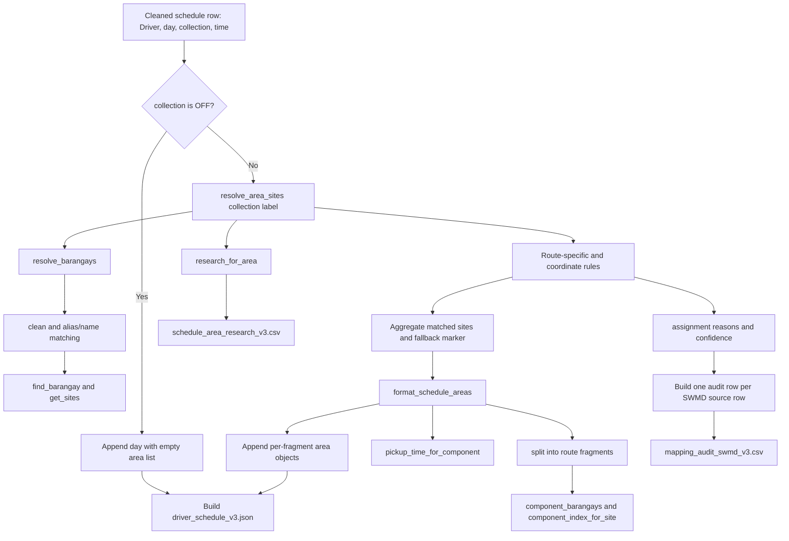

# `update_driver_json.py` guide

## Purpose

[`update_driver_json.py`](update_driver_json.py) builds the active version 3 driver schedule. It combines the cleaned driver schedule with the SWMD collection-site map, attaches site coordinates where they can be matched, and writes review files that explain how each source row and route label was handled.

The script keeps the schedule's route wording and the SWMD source rows visible. It does not try to silently turn every route phrase into a confirmed location: uncertain or unresolved routes are retained with review markers and recorded in the audit.

## Run it

From the `locations` directory:

```bash
python scripts/json_generation/update_driver_json.py
```

The script imports `pandas` in addition to Python's standard library. It resolves its data folder from the script's own location, so it reads and writes under `locations/data/`.

Running it overwrites the three generated files listed below. Make changes to the source schedule, source map, coordinate lookup, or the matching rules in the Python script; edits made directly to generated outputs will be replaced on the next run.

## Inputs

| Input | Required? | How the script uses it |
| --- | --- | --- |
| `data/csvs/cleaned/cleaned_drivers_dataset.csv` | Yes | Driver, day, collection label, and time fields used to build the schedule. The expected columns are `Driver`, `day`, `collection`, and `time`. |
| `data/csvs/raw/SWMD MAP - Baguio_SWMD_Google_MyMaps.csv` | Yes | Source barangay, site name, Purok, latitude, longitude, and Google Maps link. Each input row is preserved and assigned its original CSV row number for auditing. |
| `data/csvs/mapping/swmd_coordinate_lookup_v2.csv` | No | Adds candidate Purok, street/road, map label, lookup status, and research-link fields to site records. Rows are joined by `source_csv_row`. |
| `data/jsons/schedules/driver_schedule_swmd_map.json` | No | Supplies a legacy pickup window only when the same driver and day have one unambiguous exact-fragment or matched-barangay time. Otherwise the generated `pick up time` is blank. |

The coordinate lookup and legacy schedule are optional because the script checks whether each file exists. The cleaned schedule and raw SWMD map are read directly and must be present.

## Outputs

| Output | Contents |
| --- | --- |
| `data/jsons/schedules/driver_schedule_v3.json` | Driver schedules, route fragments, mapped site records, coordinates, review markers, and pickup times. |
| `data/csvs/mapping/schedule_area_research_v3.csv` | One row per distinct schedule collection label, with a map query, likely location, road context, references, confidence, and review flag. |
| `data/csvs/mapping/mapping_audit_swmd_v3.csv` | One row per SWMD source row, showing its schedule match or review disposition, rationale, confidence, and research links. |

### JSON shape

The file is a top-level array of drivers. Each driver has a `schedule` array. Each day contains the day name, time, and an `area` array. An area contains the schedule wording, its site records, and a pickup time:

```json
[
  {
    "driver": "Driver name",
    "schedule": [
      {
        "day": "Monday",
        "area": [
          {
            "barangay": "Exact route fragment from the cleaned schedule",
            "area_name": "Exact route fragment from the cleaned schedule",
            "sites": [
              {
                "site_name": "Source site name",
                "latitude": 16.4,
                "longitude": 120.6,
                "source_purok": "Source Purok value",
                "purok_candidate": "Candidate value from the lookup, if available"
              }
            ],
            "pick up time": ""
          }
        ],
        "time": "Schedule time"
      }
    ]
  }
]
```

The real site objects can include additional lookup fields such as `purok_check`, `street_or_road`, `map_label`, `map_lookup_status`, `map_lookup_url`, and `google_maps_url`. A site with missing or out-of-range coordinates is not emitted as a confirmed point. Its route may instead contain a marker with a blank or `firingline` `site_name` and `null` coordinates. An `OFF` schedule row has an empty `area` array while retaining its day and time.

## How generation works

1. **Load and index the source data.** The script reads the cleaned schedule and SWMD CSV, validates each coordinate against latitude and longitude ranges, keeps the source CSV row number, and groups SWMD sites by their source barangay.
2. **Add optional lookup details.** Coordinate-lookup entries are joined to SWMD rows by source CSV row number. The source's site name, barangay, and Purok are kept; lookup-derived location names are labeled as candidates or review data.
3. **Normalize names for comparison.** `clean`, `token_words`, and `repair_mojibake` normalize case, whitespace, punctuation, accents, and common encoding errors for matching. The exact schedule wording remains in the output.
4. **Resolve schedule labels.** `resolve_barangays` checks whole-label aliases, fragment aliases, and normalized barangay names. The `FULL_ALIASES` and `PART_ALIASES` tables encode known route wording that does not exactly match the SWMD barangay names.
5. **Apply route-specific rules.** `resolve_area_sites` applies extra curated rules for routes that name roads, corridors, subdivisions, or Purok ranges. Some rules select rows by coordinate proximity to named anchors (including the Camp 7 and Irisan cases); others use explicit locality or corridor associations. These rules record rationale and a confidence level for the audit.
6. **Keep uncertain pieces visible.** Invalid coordinates are excluded from confirmed site records. Unmatched route fragments, unresolved candidates, and selected corridor cases can receive a null-coordinate marker. Corridor markers use `firingline`; other fallback markers have a blank site name.
7. **Split combined route labels.** `split_schedule_components` separates comma-delimited fragments without splitting commas inside parentheses. `format_schedule_areas` groups matched sites under the most relevant fragment, preserves route text, and attaches a legacy pickup window only when the match is unambiguous.
8. **Write the schedule and review files.** The script writes the JSON, records unique route research metadata, and builds an audit row for every SWMD source row.

The route research is generated from the `ROAD_CONTEXTS` table and fixed reference URLs in the script. It creates Google Maps search links; it does not call a geocoder or fetch live map data when run.

## Function-by-function flow

The script has top-level functions rather than methods on a class. The main build loop passes each schedule's collection label into the mapping functions. Several functions also read or update shared dictionaries created at the top level; those shared values are listed after the flow diagram.



### Shared data passed between functions

Some values are not function arguments; the functions read or update them as module-level data:

- `barangay_sites` maps each source barangay name to its SWMD site rows. `source_site_rows` keeps the full ordered set of source records, and `source_site_by_row` looks up a record by its original CSV row number.
- `legacy_schedule_by_driver_day` stores optional legacy areas by `(driver, day)` for pickup-time lookup.
- `area_to_row_ids` stores the selected SWMD row numbers for each exact collection label. `format_schedule_areas` uses it to retrieve the selected site rows.
- `area_metadata` stores the research record for each collection label.
- `assignment_reasons` and `assignment_confidence` store why each SWMD row matched each collection label. The audit reads these after all driver schedules have been processed.
- `invalid_area_candidates` and `irisan_unresolved_candidates` remember possible matches that could not be emitted as confirmed site points. They cause unresolved markers and review notes to be added.

### Function inputs and outputs

| Function | What goes in | What it does and returns |
| --- | --- | --- |
| `clean(s)` | Any name or route string | Normalizes case and whitespace, removes a parenthesized schedule-time pattern for matching, and trims trailing commas. Returns a comparison key; it does not replace the displayed schedule text. |
| `repair_mojibake(value)` | Text that may have a common UTF-8 encoding glitch | Attempts to repair common `Ã`/`â€` corruption. Returns text for comparison. |
| `token_words(value)` | A name or route string | Calls `repair_mojibake`, normalizes accents, applies `clean`, and extracts lowercase letter/number words. Returns a token list used for tolerant matching. |
| `find_barangay(barangay_name)` | A possible barangay name | Looks for an exact key in `barangay_sites`, then compares normalized tokens. Returns the canonical source barangay name or `None`. |
| `get_sites(barangay_name)` | A possible barangay name | Uses `find_barangay`; returns that barangay's SWMD source rows, or an empty list when unresolved. |
| `is_corridor(area_str)` | A route label | Checks for words such as road, bridge, highway, boundary, or corridor. Returns `True` or `False`; this affects research flags and fallback marker labels. |
| `map_query(area_str)` | Exact route wording | Builds a Google Maps search URL for that wording in Baguio City. Returns the URL; it does not make a web request. |
| `research_for_area(area_str)` | Exact route wording | Uses `ROAD_CONTEXTS`, `map_query`, and corridor/Purok checks to create one research metadata dictionary: likely location, road context, links, confidence, and review flag. Saves are done by the caller. |
| `resolve_barangays(area_str)` | Exact route wording | Uses `clean`, `FULL_ALIASES`, `PART_ALIASES`, `find_barangay`, and `token_words`. Returns `(mapped, unknown)`, where mapped entries contain a source barangay, the matching wording, and a reason; unknown entries preserve unmatched fragments. |
| `distance_m(lat1, lon1, lat2, lon2)` | Two latitude/longitude pairs | Estimates their distance in meters using a local flat-earth approximation. Returns a number used by anchor-radius rules; it is not a road distance. |
| `fallback_marker(area_str)` | Unresolved route wording | Returns a site-shaped marker with null coordinates. Its `site_name` is `firingline` for a corridor label and blank otherwise. |
| `site_object(site_row)` | A validated SWMD site record | Copies the source site name and coordinates into the JSON shape and adds available lookup fields for a valid coordinate. Returns one JSON-ready site dictionary. |
| `split_schedule_components(area_str)` | A combined route label | Splits on commas outside parentheses, preserving route fragments. Returns a list of component strings. |
| `component_barangays(area_str, component)` | Whole label plus one route fragment | Applies the alias tables and barangay-name matching to find the source barangay groups associated with that fragment. Returns canonical target barangay names for grouping sites. |
| `pickup_time_for_component(driver_name, day_name, component, target_barangays)` | Driver, day, fragment, and its target barangays | Searches `legacy_schedule_by_driver_day` for an exact fragment match, then a canonical barangay match. Returns the pickup time only if all matching records agree on one value; otherwise returns an empty string. |
| `component_index_for_site(site_row, components)` | One matched SWMD site plus the route-component dictionaries | Picks the fragment whose target barangay matches the site's barangay. If there is no direct match, it uses shared name words; if there is no useful overlap, it uses the first fragment. Returns the component's zero-based index. |
| `resolve_area_sites(area_str)` | One exact collection label from the cleaned schedule | Calls `research_for_area` and `resolve_barangays`, retrieves sites with `get_sites`, then applies the route-specific and coordinate rules. Updates the shared match/review dictionaries and returns a one-item area list containing selected sites and any fallback marker. |
| `format_schedule_areas(area_str, resolved_areas, driver_name, day_name)` | The exact label, result from `resolve_area_sites`, and current driver/day | Calls `split_schedule_components`, `component_barangays`, `component_index_for_site`, `site_object`, and `pickup_time_for_component`. Returns one JSON area object per route fragment, with sites placed under fragments and any unresolved marker attached to one fragment. |

### What the main build loop feeds into them

For each row in `cleaned_drivers_dataset.csv`, the loop reads `Driver`, `day`, `collection`, and `time`. For a regular collection label, it calls `resolve_area_sites(collection)` first, then passes that result plus the same label, driver, and day to `format_schedule_areas(...)`. It appends the returned area objects and the original day/time to that driver's schedule. For `OFF`, it skips both mapping functions and appends an empty area list.

After all rows are processed, the script serializes the driver objects to the v3 JSON. It writes the research CSV from `area_metadata`. It then walks `source_site_rows` and combines the row identity with `assignment_reasons`, `assignment_confidence`, and unresolved-candidate dictionaries to make the audit CSV. So the JSON is built per schedule row, while the audit is built per SWMD source row.

## Reading the review files

### Mapping audit

Use `mapping_audit_swmd_v3.csv` to review site-to-route assignments. The main fields are:

- `source_csv_row`, `swmd_barangay`, `site_name`, and coordinates identify the original map record.
- `status` is `matched`, `blank`, or `firingline`. `blank` means no confirmed schedule assignment was made. `firingline` marks an unresolved corridor candidate whose location should not be presented as a confirmed site point.
- `matched_schedule_area` lists the route labels assigned to a matched row; `review_candidate_area` lists possible routes for an unmatched row when the script has a candidate.
- `rationale` explains an assignment or why it was left unresolved. `review_note` calls out cases needing special attention.
- `confidence` is the least certain confidence among the row's assignments. `human_review_required` is `Yes` for non-high-confidence, unmatched, or multiply assigned rows.

Confidence is a rule-based review indicator, not a statistical probability. A site can match more than one schedule route because the source map does not contain a route-ownership field; those rows are explicitly flagged.

### Schedule area research

Use `schedule_area_research_v3.csv` to review each distinct route label. It includes the exact label, likely location, named road context, a Google Maps query, cited reference URLs, a research confidence, and a human-review flag. A road context or cited source supports investigation; it does not prove that every road or subdivision lane is truck-accessible.

## Where to change matching behavior

- Add a known complete route-label mapping to `FULL_ALIASES`; add a fragment-level spelling to `PART_ALIASES` when it can be safely mapped to a single source barangay.
- Update the source coordinate review in `swmd_coordinate_lookup_v2.csv` when a candidate location has been checked. Keep source values intact and preserve the original `source_csv_row` key.
- For special route or proximity behavior, review `CAMP7_ANCHORS`, `IRISAN_ROUTE_ANCHORS`, `ROAD_CONTEXTS`, and the corresponding route-specific sections in `resolve_area_sites`.
- Review a change in all three generated outputs after rerunning the script. A hand-edited audit or research CSV is not an input to this generator and will be replaced.

Do not add loose keyword matching to force an uncertain assignment. Prefer an explicit alias, a documented route rule with a rationale, or an unresolved marker that can be reviewed.

## Code tour

| Code section | Role |
| --- | --- |
| Source loading at the top of the file | Reads the schedule, map, optional coordinate lookup, and optional legacy pickup windows. |
| `FULL_ALIASES` and `PART_ALIASES` | Curated schedule wording to SWMD barangay mappings. |
| `clean`, `token_words`, `repair_mojibake`, `find_barangay` | Normalize and compare names without changing the displayed route wording. |
| `research_for_area` | Creates review metadata and reference links for a route label. |
| `resolve_barangays` | Resolves route text to source barangays and records unknown fragments. |
| `resolve_area_sites` | Selects site rows, applies route-specific rules, and records confidence and rationale. |
| `split_schedule_components`, `component_index_for_site`, `format_schedule_areas` | Keep combined routes as separate area objects and place sites under fragments. |
| Final build and audit sections | Assemble drivers, serialize the JSON, and write the two CSV review files. |

